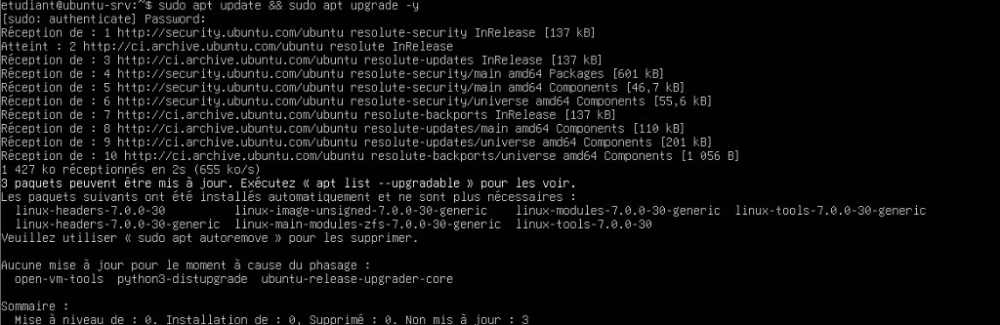
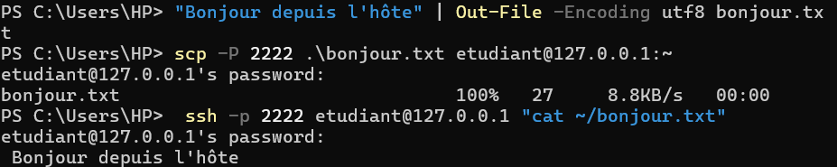

# Compte rendu TP 1 — Installation de VirtualBox et création d'une VM Ubuntu

**Cours :** Introduction au Cloud · L3 SI RIST & BDGL  
**Étudiant / trinôme :** TRAORE IBRAHIM — KOFFI BONI — DJANGORAN CHRISTIAN  
**Professeur :** Dr. Bakayoko

**Livrable :** commandes lancées, réponse de chaque commande, réponses aux questions.

> Invite hôte : `PS C:\...>`. Invite VM : `etudiant@ubuntu-srv:~$`.  
> Nom VirtualBox : `**ubuntu-s**`. Nom d'hôte Linux : `**ubuntu-srv**`. Les commandes `VBoxManage` utilisent `ubuntu-s`.

---

## Environnement


| Élément        | Valeur                                                         |
| -------------- | -------------------------------------------------------------- |
| Hôte           | Windows 11, PowerShell, utilisateur `HP`                       |
| CPU / RAM hôte | Intel Core 3 100U, 6 cœurs / 8 threads, 7832 Mo                |
| Hyperviseur    | Oracle VirtualBox 7.2.20r175154 (type 2)                       |
| Invité         | Ubuntu Server 26.04.1 LTS (`resolute`), noyau 7.0.0-38-generic |
| ISO            | `ubuntu-26.04.1-live-server-amd64.iso`                         |


---

## Partie 1 — Préparer l'hôte et installer VirtualBox

### 1.1 Virtualisation matérielle

Consigne : Gestionnaire des tâches → Performance → Processeur → « Virtualisation : Activé ».

Équivalent en ligne de commande (`VBoxManage list hostinfo`) :

```text
Processor supports HW virtualization: yes
Processor supports PAE: yes
Processor supports long mode: yes
Processor supports nested paging: yes
```

**Réponse.** VT-x est actif : on peut créer un invité 64 bits.

### 1.2 Hyperviseur de Windows

**Commande**

```powershell
bcdedit /enum | findstr hypervisorlaunchtype
```

**Réponse**

```text
hypervisorlaunchtype    Auto
```

**Lecture.** L'hyperviseur Windows (Hyper-V / WSL 2) démarre avec le système.

**Commande**

```powershell
systeminfo | findstr /C:"Hyper-V"
```

**Réponse**

```text
Configuration requise pour Hyper-V:         Un hyperviseur a ?t? d?tect?. Les fonctionnalit?s n?cessaires ? Hyper-V ne seront pas affich?es.
```

*(Encodage console : « Un hyperviseur a été détecté. »)*

**Lecture.** Un hyperviseur est déjà présent. VirtualBox tourne donc **au-dessus** de l'hyperviseur Windows (un peu plus lent ; dépannage : `bcdedit /set hypervisorlaunchtype off` puis redémarrage).

### 1.3 Installation et vérification

**Commande**

```powershell
$env:Path += ";C:\Program Files\Oracle\VirtualBox"
```

**Réponse.** Aucune sortie : le dossier VirtualBox est ajouté au `PATH` de la session.

**Commande**

```powershell
VBoxManage --version
```

**Réponse**

```text
7.2.20r175154
```

**Lecture.** VirtualBox **7.2.20** est installé (branche 7.2 de la consigne).

**Commande**

```powershell
VBoxManage list hostinfo
```

**Réponse**

```text
Host Information:

Host time: 2026-10-14T18:28:07.617000000Z
Processor online count: 8
Processor count: 8
Processor online core count: 6
Processor core count: 6
Processor supports HW virtualization: yes
Processor supports PAE: yes
Processor supports long mode: yes
Processor supports nested paging: yes
Memory size: 7832 MByte
Memory available: 695 MByte
Operating system: Windows 11
Operating system version: 10.0.26200.9711
```

**Lecture.** Hôte : **6 cœurs**, **8 processeurs logiques**, **7832 Mo** de RAM, virtualisation matérielle **oui**, Windows 11.

### Réponses aux questions

**Qu'est-ce qu'un hyperviseur de type 1 et de type 2 ? Dans quelle catégorie se range VirtualBox ? Citez un hyperviseur de type 1 utilisé par un fournisseur cloud.**

- **Type 1** (bare metal) : s'exécute **directement sur le matériel** (KVM, Xen, VMware ESXi, Hyper-V).
- **Type 2** (hébergé) : s'exécute **dans un OS hôte** (VirtualBox, VMware Workstation).
- **VirtualBox est de type 2**.
- Cloud : **KVM** (AWS Nitro, Google Cloud), **Hyper-V** (Azure).

**Pourquoi la virtualisation matérielle (VT-x / AMD-V) est-elle indispensable pour une VM 64 bits ?**

Elle permet à l'invité de tourner **sur le CPU**, l'hyperviseur n'interceptant que les instructions sensibles. Sans VT-x / AMD-V, il faudrait émuler le processeur : trop lent, et VirtualBox ne propose plus que des invités 32 bits.

**Quelle version de VirtualBox ? Que renvoie `list hostinfo` (cœurs et RAM) ?**

- **7.2.20r175154**
- **6 cœurs / 8 threads**, **7832 Mo**, VT-x **oui**

---

## Partie 2 — Télécharger et vérifier l'image ISO Ubuntu

ISO **26.04.1** (point release de la 26.04 LTS) et fichier `SHA256SUMS.txt`.

**Commande**

```powershell
cd $HOME\Downloads
```

**Réponse.** Le prompt devient `PS C:\Users\HP\Downloads>`.

**Commande**

```powershell
Get-FileHash .\ubuntu-26.04.1-live-server-amd64.iso -Algorithm SHA256
```

**Réponse**

```text
Algorithm       Hash                                                                   Path
---------       ----                                                                   ----
SHA256          CC8A95CDE20F6CED61A322420DE00F10CC3C90CED545DAA46CB9C1A117F1D927       C:\Users\HP\D...
```

**Commande**

```powershell
Select-String -Path .\SHA256SUMS.txt -Pattern "live-server-amd64"
```

**Réponse**

```text
SHA256SUMS.txt:2:dec49008a71f6098d0bcfc822021f4d042d5f2db279e4d75bdd981304f1ca5d9 *ubuntu-26.04-live-server-amd64.iso
SHA256SUMS.txt:5:cc8a95cde20f6ced61a322420de00f10cc3c90ced545daa46cb9c1a117f1d927 *ubuntu-26.04.1-live-server-amd64.iso
```

**Lecture.** Empreinte calculée = empreinte officielle de `ubuntu-26.04.1-live-server-amd64.iso` (la casse hexadécimale n'importe pas). L'ISO n'est ni corrompue ni altérée.

**Taille de l'ISO** (Propriétés) : **2 927 861 760 octets** (2,73 Gio).

### Réponses aux questions

**Les deux empreintes sont-elles identiques ? Pourquoi vérifier avant d'installer ?**

Oui. On détecte une **corruption** (téléchargement incomplet) et une **image piégée**. `SHA256SUMS` doit venir du site officiel (HTTPS).

**Ubuntu Desktop vs Server ? Pourquoi Server pour le cloud ?**

Desktop : interface graphique. Server : **ligne de commande / SSH**, plus léger, **moins de surface d'attaque**. Une instance cloud n'a pas d'écran.

**Que signifie LTS ? Combien d'années de mises à jour de sécurité standard ?**

*Long Term Support*. **5 ans** (jusqu'en 2031 pour la 26.04). Ubuntu Pro peut prolonger.

---

## Partie 3 — Créer et configurer la machine virtuelle

VM créée avec **Nouvelle**, installation sans surveillance **désactivée**.


| Paramètre      | Consigne                | Observé     |
| -------------- | ----------------------- | ----------- |
| Nom VirtualBox | `ubuntu-srv`            | `ubuntu-s`  |
| Type           | Linux / Ubuntu 64-bit   | oui         |
| RAM            | 2048 Mo                 | 2048 MB     |
| CPU            | 2                       | 2           |
| Disque         | VDI 25 Go dynamique     | `sda` 25 G  |
| Réseau         | NAT                     | NAT         |
| Redirection    | `127.0.0.1:2222` → `22` | règle `ssh` |


**Commande**

```powershell
VBoxManage showvminfo ubuntu-s
```

**Réponse (extraits)**

```text
Name:                        ubuntu-s
Memory size:                 2048MB
Number of CPUs:              2
NIC 1:                       MAC: 0800270ECB97, Attachment: NAT, Cable connected: on, ...
NIC 1 Rule(0):   name = ssh, protocol = tcp, host ip = 127.0.0.1, host port = 2222, guest ip = , guest port = 22
```

**Lecture.** Mémoire, CPU, NAT et redirection SSH sont conformes. Le `.vdi` dynamique pèse ~7 Go après usage (très inférieur à 25 Go réservés).

### Réponses aux questions

**Disque dynamique vs taille fixe ? Place du `.vdi` juste après création ?**

- **Fixe** : 25 Go pris tout de suite sur l'hôte.
- **Dynamique** : le fichier **grandit avec les écritures**, jusqu'à 25 Go.
- À la création : quelques Mo (en-tête). Ici, après install + instantané : ~7 Go.

**Pourquoi désactiver l'installation sans surveillance ?**

Pour **faire chaque écran** (langue, clavier, LVM, profil `etudiant` / `ubuntu-srv`, OpenSSH) au lieu des défauts automatiques.

**Pourquoi l'hôte ne joint pas la VM en NAT ? Rôle de 2222 → 22 ?**

La VM est sur un **réseau privé** `10.0.2.0/24` : NAT autorise les sorties, pas les entrées. La redirection envoie `127.0.0.1:2222` vers le port **22** (SSH) de l'invité.

---

## Partie 4 — Installer Ubuntu Server

Durée chronométrée : **23 min 48 s**.


| Écran            | Choix                                 | Pourquoi            |
| ---------------- | ------------------------------------- | ------------------- |
| Langue           | Français                              | consigne            |
| MAJ installateur | Continuer sans mettre à jour          | `apt` ensuite       |
| Clavier          | French AZERTY                         | clavier du PC       |
| Type             | Ubuntu Server (non minimisée)         | outils d'admin      |
| Réseau           | `enp0s3` DHCP → `10.0.2.15`           | NAT VirtualBox      |
| Stockage         | tout le disque, LVM                   | volumes extensibles |
| Profil           | serveur `ubuntu-srv`, user `etudiant` | consigne            |
| Ubuntu Pro       | Passer                                | non requis          |
| SSH              | Installer OpenSSH                     | accès distant       |
| Snaps            | aucun                                 | système minimal     |


### Réponses aux questions

**Combien de temps ? Comparaison avec une instance cloud.**

**23 min 48 s** depuis l'ISO. Une instance cloud part d'une **image déjà installée** : **1 à 2 minutes**, config injectée (cloud-init, clé SSH). C'est ce que l'IaaS automatise.

**Adresse IP sur `enp0s3` ? Qui l'a attribuée ?**

`**10.0.2.15/24**`, en DHCP, par le **NAT VirtualBox** (routeur `10.0.2.2`).

**Pourquoi OpenSSH dès l'install ? Sans SSH sur un serveur cloud ?**

SSH est **l'accès d'administration** (pas d'écran). Sans SSH : plus d'accès, sauf console série du fournisseur.

---

## Partie 5 — Premiers pas, réseau et accès SSH

### 5.1 Système et ressources

**Commande**

```bash
lsb_release -a
```

**Réponse**

```text
No LSB modules are available.
Distributor ID: Ubuntu
Description:    Ubuntu 26.04.1 LTS
Release:        26.04
Codename:       resolute
```

**Lecture.** Ubuntu **26.04.1 LTS**, nom de code `resolute`.

**Commande**

```bash
uname -r
```

**Réponse**

```text
7.0.0-38-generic
```

**Lecture.** Noyau Linux 7.0.0-38.

**Commande**

```bash
hostnamectl
```

**Réponse**

```text
 Static hostname: ubuntu-srv
       Icon name: computer-vm
         Chassis: vm ♦
      Machine ID: 95af8f555cd24fb29a89b1361df075df
         Boot ID: 9f0d1c1371054e1dbf81bf0a7b5f6e42
  Virtualization: oracle
Operating System: Ubuntu 26.04.1 LTS
          Kernel: Linux 7.0.0-38-generic
    Architecture: x86-64
 Hardware Vendor: innotek GmbH
  Hardware Model: VirtualBox
```

**Lecture.** Hostname `**ubuntu-srv`**, invité VirtualBox (`Virtualization: oracle`).

**Commande**

```bash
nproc
```

**Réponse**

```text
2
```

**Lecture.** **2** processeurs, comme configuré.

**Commande**

```bash
free -h
```

**Réponse**

```text
               total        used        free      shared  buff/cache   available
Mem:           1,6Gi       359Mi       1,1Gi       1,0Mi       325Mi       1,3Gi
Swap:          2,0Gi          0B       2,0Gi
```

**Lecture.** ~1,6 Gio visibles sur 2048 Mo (reste au noyau). Swap 2 Gio inutilisé.

**Commande**

```bash
df -h /
```

**Réponse**

```text
Filesystem                         Size  Used Avail Use% Mounted on
/dev/mapper/ubuntu--vg-ubuntu--lv   12G  5,4G  5,3G  51% /
```

**Lecture.** Racine sur volume LVM, ~12 Go (pas tout le disque 25 Go : espace libre dans le VG).

**Commande**

```bash
lsblk
```

**Réponse**

```text
NAME                      MAJ:MIN RM   SIZE RO TYPE MOUNTPOINTS
sda                         8:0    0    25G  0 disk
├─sda1                      8:1    0     1M  0 part
├─sda2                      8:2    0     2G  0 part /boot
└─sda3                      8:3    0    23G  0 part
  └─ubuntu--vg-ubuntu--lv 252:0    0  11,5G  0 lvm  /
```

**Lecture.** Disque virtuel **25 Go**, LVM, LV racine 11,5 Go.

### 5.2 Réseau et Internet

**Commande**

```bash
ip -4 addr show
```

**Réponse**

```text
1: lo: ...
    inet 127.0.0.1/8 scope host lo
2: enp0s3: ...
    inet 10.0.2.15/24 metric 100 brd 10.0.2.255 scope global dynamic enp0s3
       valid_lft 85668sec preferred_lft 85668sec
```

**Lecture.** IP `**10.0.2.15/24`**, DHCP (`dynamic`).

**Commande**

```bash
ip route
```

**Réponse**

```text
default via 10.0.2.2 dev enp0s3 proto dhcp src 10.0.2.15 metric 100
10.0.2.0/24 dev enp0s3 proto kernel scope link src 10.0.2.15 metric 100
10.0.2.2 dev enp0s3 proto dhcp scope link src 10.0.2.15 metric 100
192.168.1.254 via 10.0.2.2 dev enp0s3 proto dhcp src 10.0.2.15 metric 100
```

**Lecture.** Passerelle par défaut `**10.0.2.2`** (routeur NAT VirtualBox).

**Commande**

```bash
resolvectl status | grep "DNS Servers"
```

**Réponse**

```text
       DNS Servers: 192.168.1.254 fd17:625c:f037:2::3
```

**Lecture.** DNS de l'hôte (box `192.168.1.254`), transmis à la VM.

**Commande**

```bash
ping -c 3 ubuntu.com
```

**Réponse**

```text
PING ubuntu.com (185.125.190.47) 56(84) bytes of data.
64 bytes from davybones.canonical.com (185.125.190.47): icmp_seq=1 ttl=64 time=709 ms
64 bytes from davybones.canonical.com (185.125.190.47): icmp_seq=2 ttl=64 time=141 ms
64 bytes from davybones.canonical.com (185.125.190.47): icmp_seq=3 ttl=64 time=108 ms

--- ubuntu.com ping statistics ---
3 packets transmitted, 3 received, 0% packet loss, time 7482ms
```

**Lecture.** DNS + Internet OK (3/3, 0 % de perte).

**Commande**

```bash
sudo apt update && sudo apt upgrade -y
```

**Réponse** (capture de la session)



**Lecture.** Les dépôts `resolute` répondent. **0 paquet mis à niveau**, **3 retenus par le phasage** (`open-vm-tools`, `python3-distupgrade`, `ubuntu-release-upgrader-core`). D'anciens paquets noyau `7.0.0-30` peuvent être retirés avec `apt autoremove`. Le système est à jour.

### 5.3 SSH écoute-t-il ?

**Commande**

```bash
systemctl status ssh --no-pager
```

**Réponse**

```text
* ssh.service - OpenBSD Secure Shell server
     Loaded: loaded (/usr/lib/systemd/system/ssh.service; disabled; preset: enabled)
     Active: inactive (dead)
TriggeredBy: ● ssh.socket
```

**Lecture.** Le service est « dead » mais **activé par socket** (`ssh.socket`) : normal sur Ubuntu récent.

**Commande**

```bash
sudo ss -tlnp | grep :22
```

**Réponse**

```text
LISTEN 0      4096         0.0.0.0:22        0.0.0.0:*    users:(("systemd",pid=1,fd=106))
LISTEN 0      4096            [::]:22           [::]:*    users:(("systemd",pid=1,fd=107))
```

**Lecture.** **systemd (PID 1)** écoute sur le port **22** IPv4 et IPv6 et lancera `sshd` à la première connexion. OpenSSH est joignable.

### 5.4 SSH depuis l'hôte et copie de fichier

**Commande**

```powershell
ssh -p 2222 etudiant@127.0.0.1
```

**Réponse.** Première fois : empreinte de l'hôte `[127.0.0.1]:2222`, confirmation `yes`, mot de passe `etudiant`. Session ouverte sur `etudiant@ubuntu-srv`. `exit` pour quitter.

**Commandes** (création du fichier, copie, affichage)

```powershell
"Bonjour depuis l'hôte" | Out-File -Encoding utf8 bonjour.txt
scp -P 2222 .\bonjour.txt etudiant@127.0.0.1:~
ssh -p 2222 etudiant@127.0.0.1 "cat ~/bonjour.txt"
```

**Réponse** (capture)



**Lecture.** `scp` transfère 27 octets (100 %). `cat` affiche `Bonjour depuis l'hôte` : le fichier est bien dans le home de `etudiant`.

### Réponses aux questions

**IP, masque, passerelle, DNS ? Rôle de 10.0.2.2 ?**


| Paramètre  | Valeur                                   |
| ---------- | ---------------------------------------- |
| IP         | `10.0.2.15`                              |
| Masque     | `/24` (`255.255.255.0`)                  |
| Passerelle | `10.0.2.2`                               |
| DNS        | `192.168.1.254` et `fd17:625c:f037:2::3` |


`10.0.2.2` = **routeur NAT de VirtualBox** (pour la VM, c'est aussi l'hôte).

**Pourquoi 127.0.0.1:2222 et pas 10.0.2.15:22 ?**

`10.0.2.15` est **interne au NAT**, injoignable depuis Windows. Seule la redirection locale `2222 → 22` ouvre SSH.

**Message de première connexion SSH ? Risque évité ?**

Empreinte de la **clé d'hôte**, enregistrée dans `known_hosts`. Évite une attaque **homme du milieu**. Si la clé change : `REMOTE HOST IDENTIFICATION HAS CHANGED` → `ssh-keygen -R "[127.0.0.1]:2222"`.

**Avantages de la clé vs mot de passe ? Pourquoi le cloud l'impose ?**

Clé plus robuste, secret qui **ne circule pas**, automatisable, révocable. Les instances sont **exposées sur Internet** : les scans de mots de passe sont constants.

---

## Partie 6 — Instantané, clone et arrêt

### 6.1 Instantané

**Commande**

```powershell
VBoxManage snapshot ubuntu-s take apres-installation --description "Ubuntu installé, OpenSSH actif"
```

**Réponse**

```text
0%...10%...20%...30%...40%...50%...60%...70%...80%...90%...100%
Snapshot taken. UUID: f1641156-7c15-4a98-9b5a-9567718e4d46
```

**Lecture.** Instantané `apres-installation` créé.

**Commande**

```powershell
VBoxManage snapshot ubuntu-s list
```

**Réponse**

```text
   Name: apres-installation (UUID: f1641156-7c15-4a98-9b5a-9567718e4d46) *
   Description: Ubuntu installé, OpenSSH actif
```

**Lecture.** `*` = état courant de la VM.

### 6.2 Modification puis arrêt

**Commande**

```bash
sudo apt install -y htop
```

**Réponse.** Paquet `htop` installé (binaire `/usr/bin/htop`).

**Commande**

```bash
touch ~/avant-restauration.txt
```

**Réponse.** Fichier vide créé dans le home.

**Commande**

```bash
sudo poweroff
```

**Réponse.** La VM s'éteint proprement.

### 6.3 Restauration headless

**Commande**

```powershell
VBoxManage snapshot ubuntu-s restore apres-installation
```

**Réponse**

```text
Restoring snapshot 'apres-installation' (f1641156-7c15-4a98-9b5a-9567718e4d46)
0%...10%...20%...30%...40%...50%...60%...70%...80%...90%...100%
```

**Commande**

```powershell
VBoxManage startvm ubuntu-s --type headless
```

**Réponse**

```text
Waiting for VM "ubuntu-s" to power on...
VM "ubuntu-s" has been successfully started.
```

**Lecture.** Démarrage **sans fenêtre**, comme une instance cloud.

**Commande**

```powershell
ssh -p 2222 etudiant@127.0.0.1 "which htop; ls ~"
```

**Réponse**

```text
etudiant@127.0.0.1's password:
/usr/bin/htop
bonjour.txt
```

**Lecture.** `avant-restauration.txt` **a disparu** (créé après l'instantané). `bonjour.txt` **reste** (copié avant). `htop` est encore là : il était **déjà dans l'instantané**. La restauration ramène l'état figé, elle n'efface que ce qui est **postérieur**.

### 6.4 Clone et port 2223

**Commande**

```powershell
VBoxManage controlvm ubuntu-s acpipowerbutton
```

**Réponse.** Pas de texte : signal ACPI d'arrêt propre.

**Commande**

```powershell
VBoxManage clonevm ubuntu-s --name ubuntu-clone --register
```

**Réponse**

```text
0%...10%...20%...30%...40%...50%...60%...70%...80%...90%...100%
Machine has been successfully cloned as "ubuntu-clone"
```

**Commande**

```powershell
VBoxManage modifyvm ubuntu-clone --natpf1 delete ssh
```

**Réponse.** Ancienne règle `2222` du clone supprimée (évite le conflit de port).

**Commande**

```powershell
VBoxManage modifyvm ubuntu-clone --natpf1 "ssh,tcp,127.0.0.1,2223,,22"
```

**Réponse.** Nouvelle règle : hôte **2223** → invité **22**.

**Commande**

```powershell
VBoxManage startvm ubuntu-clone --type headless
```

**Réponse**

```text
Waiting for VM "ubuntu-clone" to power on...
VM "ubuntu-clone" has been successfully started.
```

**Commande**

```powershell
VBoxManage list runningvms
```

**Réponse**

```text
"ubuntu-clone" {a89dbdb0-3d0f-4b4c-8228-70f4d7e1c724}
```

**Lecture.** Seul le clone tourne : `ubuntu-s` s'est bien arrêtée.

### 6.5 Espace disque et suppression du clone

**Commande**

```powershell
Get-ChildItem "$HOME\VirtualBox VMs" -Directory | ForEach-Object { "{0} : {1:N2} Go" -f $_.Name, ((Get-ChildItem $_.FullName -Recurse -File | Measure-Object Length -Sum).Sum / 1GB) }
```

**Réponse**

```text
ubuntu-clone : 6,92 Go
ubuntu-s : 7,33 Go
```

**Lecture.** Clone **complet** (copie indépendante, taille comparable). L'original est un peu plus gros à cause de l'instantané.

**Commande**

```powershell
VBoxManage controlvm ubuntu-clone acpipowerbutton
```

**Réponse.** Arrêt ACPI du clone.

**Commande**

```powershell
VBoxManage unregistervm ubuntu-clone --delete
```

**Réponse**

```text
0%...10%...20%...30%...40%...50%...60%...70%...80%...90%...100%
```

**Lecture.** Clone et fichiers disque supprimés.

**Commande**

```powershell
VBoxManage list vms
```

**Réponse**

```text
"ubuntu-s" {68371ad6-da36-4063-adbf-088829a96be1}
```

**Lecture.** Il ne reste que `**ubuntu-s`**, conservée pour les TP suivants.

### Réponses aux questions

**Instantané vs clone ? Un instantané est-il une sauvegarde ?**

- **Instantané** : état d'**une** VM ; disque parent + **différentiel** (dépend de l'original).
- **Clone** : **nouvelle VM indépendante**.
- Un instantané **n'est pas une sauvegarde** : même disque hôte. Panne = perte de la VM **et** des instantanés.

**Équivalents cloud ?**

- Instantané → **snapshot de disque** (EBS, disque Azure).
- Clone → **image** (AMI, image Azure).

`**acpipowerbutton` vs `poweroff` ?**

- `acpipowerbutton` : **arrêt propre**.
- `poweroff` : **coupure brutale** (risque de corruption).

**Pourquoi le mode headless ? Lien avec le cloud ?**

Pas de fenêtre : on administre en SSH. C'est le modèle d'une **instance cloud**.

**Pourquoi changer le port hôte et le hostname du clone ?**

- **Port** : le clone hérite de 2222 ; deux VM ne peuvent pas prendre le même port hôte → **2223**.
- **Hostname** : sinon les deux s'appellent `ubuntu-srv` (confusion invite / journaux / DNS).

---

## Conclusion — ce qu'il faut retenir du TP

Ce TP simule, en local, ce qu'un fournisseur IaaS fait pour vous : **hyperviseur + VM + réseau + accès distant + copies d'état**.

Un **hyperviseur de type 1** tourne sur le matériel (KVM, Hyper-V dans le cloud). Un **type 2** (VirtualBox) tourne dans Windows. Les invités **64 bits** exigent **VT-x / AMD-V**. VirtualBox 7.2.20 est installé ; l'hôte a 6 cœurs et ~8 Go de RAM.

On n'installe jamais une ISO sans **vérifier le SHA-256** contre `SHA256SUMS` officiel. Ici l'empreinte de `ubuntu-26.04.1-live-server-amd64.iso` est identique. **LTS** = 5 ans de correctifs. **Server** (sans bureau) est le bon choix cloud : plus léger, moins d'attaque.

2 Go RAM, 2 CPU, disque **VDI dynamique** 25 Go (le fichier hôte ~7 Go seulement). **NAT** : la VM sort sur Internet (`10.0.2.15`, passerelle `10.0.2.2`) mais l'hôte ne rentre pas, d'où la **redirection 2222 → 22**. L'installateur sans surveillance est **désactivé** pour maîtriser chaque choix. Installation ISO : **~24 min** vs **1–2 min** pour une instance cloud déjà imagée.

Ubuntu 26.04.1, hostname `ubuntu-srv`, user `etudiant`, LVM, OpenSSH. Réseau : IP / masque / GW / DNS relevés ; `ping` et `apt` prouvent Internet. SSH écoute via `**ssh.socket`**. Depuis Windows : `ssh -p 2222 etudiant@127.0.0.1` et `scp` (fichier `bonjour.txt`). La **première empreinte SSH** protège contre l'homme du milieu ; en production on préfère une **clé** au mot de passe.

**Instantané ≠ sauvegarde ≠ clone.** L'instantané `apres-installation` permet de **revenir en arrière** (`avant-restauration.txt` disparaît). Il reste lié au disque parent. Un **clone** est une VM à part (`ubuntu-clone`, port **2223**) ; il occupe autant de place. On démarre en **headless** (comme le cloud), on arrête avec `**acpipowerbutton`** (propre, pas `poweroff`). Le clone a été **supprimé** ; `**ubuntu-s`** est gardée, avec son instantané, pour la suite.

En une phrase : **une instance cloud = une VM déjà installée, sans écran, joignable en SSH, clonable depuis une image, dont on peut figer le disque par snapshot** 